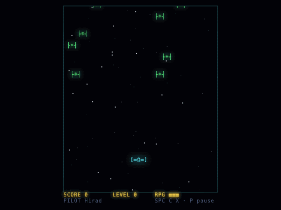

# STARFALL

A neo-retro terminal space shooter that runs in the browser. It's a 2026 rebuild of **"Star Wars"**, a C++ console game I wrote in 2019.

**[▶ Play it](https://hiradbaba.github.io/starfall/)**



## Controls

| Action                             | Keyboard          | Touch |
| ---------------------------------- | ----------------- | ----- |
| Move                               | Arrow keys / WASD | D-pad |
| Fire (kills green ships)           | Space             | FIRE  |
| Special shot (kills magenta ships) | C                 | SPEC  |
| RPG: clears the screen, 3 per game | X                 | RPG   |
| Pause / Save & Quit                | P or Esc          | II    |
| Mute                               | M                 |       |

You level up every 10 kills. Each level brings more ships; magenta ships appear from level 2, and every third level is faster.

## 2019 → 2026

The original was a single 700-line `PRO.cpp` for the Windows console. It used `conio.h` to read keys, `SetConsoleCursorPosition` to draw and `Beep()` for the music:

```cpp
if(_kbhit()){
    a=_getch();
    if(a==UP && me.y>0){
        me.y--;
    }
    ...
    goxy(copy.x,copy.y);
    printf("     ");
    continue;   // ← skips the rest of the frame: enemies freeze while you hold a key
}
```

The rebuild keeps the same game: the same three weapons, the same enemy types, the same level curve, pilot names, save/continue and a high score. The code is now organised into layers:

- `src/core/`: the game as pure TypeScript functions. `step(state, input) → { state, events }` advances one tick. There is no DOM in this layer; a lint rule enforces that, and every rule has a unit test.
- `src/render/`: a canvas character grid with CRT scanlines, glow, particles, screen shake and a parallax starfield.
- `src/audio/`: Web Audio synthesis, so there are no audio files. It plays an original theme.
- `src/input/`: keyboard and touch both produce the same per-tick `InputFrame`.
- `src/screens/`: the menu, name entry, play, pause, game over and high-score screens.

### Bugs in my 2019 logic, and how they're fixed

| #   | 2019 bug                                                                                        | Fix                                                               |
| --- | ----------------------------------------------------------------------------------------------- | ----------------------------------------------------------------- |
| 1   | Holding a key froze the world (`continue` skipped the update)                                   | The world advances every tick                                     |
| 2   | An enemy and the ship could swap rows without colliding                                         | Swept collision                                                   |
| 3   | Bullets tunnelled through enemies, and the two shot types had different hitboxes                | Swept collision with one hitbox rule                              |
| 4   | Dead enemies (`x = NULL`) kept falling and could kill you at the left edge                      | Dead entities are removed                                         |
| 5   | Special-enemy loops ran over `en.n` instead of `spen.n`, which created ghost enemies            | Separate collections                                              |
| 6   | Several kills in one tick scored only 1                                                         | Every kill counts                                                 |
| 7   | The RPG scored off-screen enemies and detonated at an absolute row                              | Scores on-screen kills only and detonates after 10 rows of travel |
| 8   | Jumping several levels at once applied the difficulty only once                                 | Applied per level                                                 |
| 9   | The tick delay went negative around level 15, so `Sleep()` hung the game                        | 40 ms floor                                                       |
| 10  | Gaps between waves                                                                              | The next wave is queued as soon as the last one enters the screen |
| 11  | `srand(time)` was reseeded every wave, so waves repeated, and the overlap retry loop could spin | One seeded RNG, sampling only free cells                          |
| 12  | Continue could resume a game you'd already lost                                                 | The save is cleared on game over                                  |
| 13  | Continue lost the level and speed                                                               | The full state is saved                                           |
| 14  | Missing files crashed the game; long names overflowed a buffer; spaces in names broke the save  | Validated JSON storage and bounded names                          |
| 15  | The high score was only checked on death                                                        | Also checked on Save & Quit                                       |
| 16  | Bullet arrays never shrank and overflowed after 10,000 shots                                    | Off-screen bullets are removed                                    |

Each fix has a regression test in `tests/core/`.

## Development

```bash
npm install
npm run dev          # http://localhost:5173
npm test             # unit tests
npm run e2e          # browser smoke tests (needs: npx playwright install chromium)
npm run build
```

To regenerate the GIF, run `npm run build && npm run preview`, and in another terminal run `npm run gif`.

Built with TypeScript, Canvas 2D, Web Audio and Vite. No game engine.
